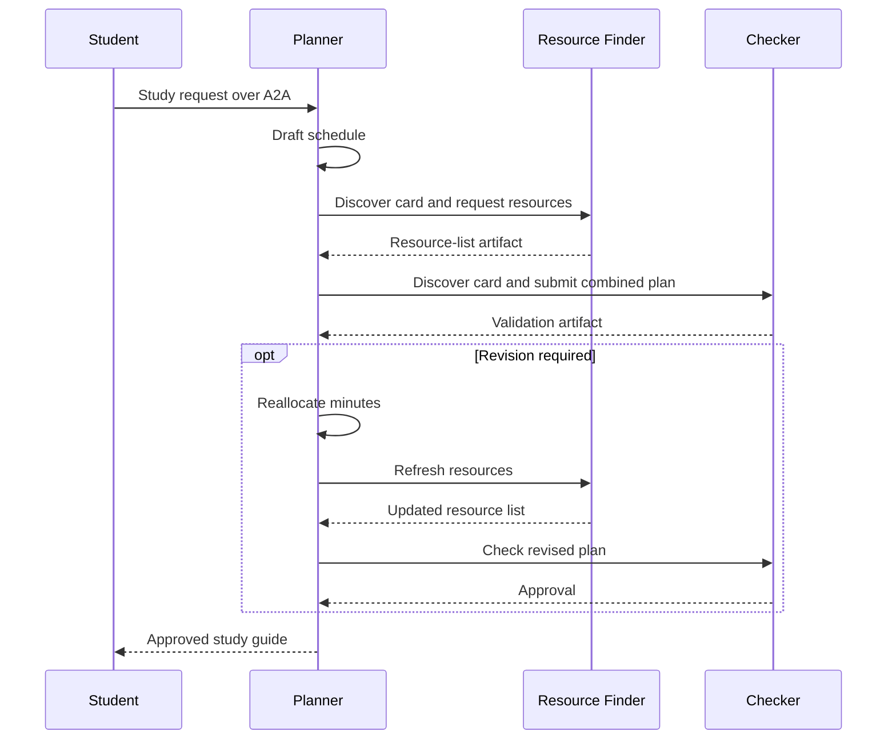

# a2a-agents-demo

Three local agents collaborate through **real A2A 1.0 JSON-RPC over HTTP**, using
the official `a2a-sdk`. Each agent runs in its own process and publishes an Agent Card.

| Agent | Default address | Responsibility |
| --- | --- | --- |
| Study Planner | http://127.0.0.1:8000 | Drafts schedules, delegates work, incorporates checker feedback |
| Resource Finder | http://127.0.0.1:8001 | Assembles curated links, descriptions, and study-time estimates |
| Schedule Checker | http://127.0.0.1:8002 | Independently validates coverage, time budgets, and resource constraints |

## Three-agent quickstart

### Browser presentation (recommended for the workshop)

```powershell
.\run-visual.cmd
```

Open **http://127.0.0.1:8080**. Click **Run the demo** to watch the three-agent
network, a readable conversation, the checker rejection, and the repaired plan.
The browser server starts its own agents on ports 8100-8102 and stops them when
you stop the server with Ctrl+C. No new packages are needed.

- **Pause / Next step / Replay:** present the actual execution events at your pace.
  These controls pause playback, not the agent execution. The page labels this.
- **Study guide:** the approved schedule and complete resource list.
- **View Agent Card:** the actual discovery document from each running agent.
- **Under the hood:** real A2A message IDs, task states, and structured payloads.
- **Planner mode:** scripted, with no API calls by default; Gemini is optional.

Browser events come from the real workflow over a local event stream. This is
an interface to the existing A2A agents, not a separate animated simulation.
Use `--port 8085 --base-port 8200` if the default ports are occupied.

### Terminal presentation

The `.venv` has been installed on this computer. In PowerShell in this folder:

```powershell
.\run-demo.cmd --show-repair
```

This starts all three agents, runs a sample request, prints the actual A2A
discovery, messages and task IDs, then stops its processes. Offline mode is the
default: planning is scripted and the specialists use local Python logic.
There are no model calls or API charges in offline mode. The A2A communication
is actual localhost HTTP, not mocked.

`--show-repair` deliberately adds extra minutes to the first draft. The checker
detects the violation and the planner repairs it, refreshes the resources and
requests another independent check. The console labels the injected mistake.
Omit the flag for a normal run.



Other examples:

```powershell
.\run-demo.cmd --subject python --topics variables loops functions recursion --days 2 --minutes 60
.\run-demo.cmd --json
.\run-demo.cmd --base-port 8100
```

`--json` also prints the full structured result. `--base-port` shifts all three
ports together, without stopping unrelated processes using the default ports.

## Inspect Agent Cards and send requests separately

```powershell
.\run-demo.cmd --serve
```

Open `http://127.0.0.1:8000/.well-known/agent-card.json` in a browser. The resource
finder and checker expose the same path on ports 8001 and 8002.
In another terminal:

```powershell
.\run-demo.cmd --client-only --show-repair
```

Ctrl+C in the server terminal stops all three child processes. Servers bind only
to localhost. Task state lives in memory and clears when the processes stop.

## Optional Gemini planner

```powershell
.\run-demo.cmd --mode gemini
```

Only the planner calls Gemini; the resource finder and checker stay local.
Existing `.env` credentials are preserved. Use `GEMINI_API_KEY` and optional
`GEMINI_MODEL` (default `gemini-3.1-flash-lite`). Gemini mode does not silently
fall back to scripted mode. Your earlier key returned a regional quota of zero;
resolve that before relying on live inference for a presentation.

When a draft fails checking, the planner uses deterministic time allocation to
repair it, then asks both specialists to process the revision again.

## How to present it

1. Show the three Agent Cards: name, skill, protocol binding, and endpoint.
2. Run `--show-repair` and watch A2A discovery and task IDs appear.
3. Point out the resource finder returning its own artifact.
4. Show the checker flagging the overbooked day.
5. Show the revised schedule and final approval.

The resource list comes from `a2a_demo/resources.json`, rather than live web
search. URLs point to Paul's Online Math Notes and Python documentation.
Durations and difficulty ratings are local demo estimates, not publisher
durations or assessments of a particular student. The checker validates catalog
membership, coverage and budgets, not live URL availability or academic quality.

## Architecture files

- `a2a_demo/server.py`: cards, A2A task lifecycle, and role dispatch
- `a2a_demo/transport.py`: card discovery and SDK client requests
- `a2a_demo/workflow.py`: planner, Gemini option, and bounded repair
- `a2a_demo/domain.py`: contracts, allocation, selection, and validation
- `a2a_demo/resources.json`: curated resource collection
- `run_demo.py`: process lifecycle, CLI, and final study guide
- `visual_demo.py`: local browser server and execution event stream
- `a2a_demo/web/`: the visual interface, playback controls, and guide display
- `a2a_demo/observer.py`: optional event reporting, inactive in the terminal demo
- `main.py`: original single-agent demo retained below

## Install elsewhere and test

Python 3.13 was used for this demo.

```powershell
python -m venv .venv
.\.venv\Scripts\python.exe -m pip install -r requirements.txt
.\run-demo.cmd --show-repair
.\.venv\Scripts\python.exe -m unittest discover -s tests -v
```

Tests use offline mode and do not call Gemini. They cover invalid plans,
incomplete resources, real three-process A2A communication, and repair.

References: [A2A server tutorial](https://a2a-protocol.org/latest/tutorials/python/5-start-server/),
[A2A client tutorial](https://a2a-protocol.org/latest/tutorials/python/6-interact-with-server/),
[Agent Card guide](https://agent2agent.info/docs/concepts/agentcard/).

---

# Original single-agent demo

A small terminal demo using Gemini with the OpenAI Agents SDK: one model, one local tool,
and tool calls printed on screen. This is a single-agent demo, not an A2A server.

## Run

Open PowerShell in this folder. Your installed Python already has the required
packages. If you use a different environment, install them first:

```powershell
python -m pip install -r requirements.txt
```

Create a Gemini key at https://aistudio.google.com/apikey.
Open `.env`, enter it after `GEMINI_API_KEY=`, and save it.
The default model is `gemini-3.1-flash-lite`, which has a limited free API tier.
Use an eligible project on the free tier to avoid paid usage. Quotas and model
availability depend on your account. You can set another model with `GEMINI_MODEL`.
Existing OpenAI settings in `.env` are ignored by this demo.

The Agents SDK still manages the tool loop. Its model client sends requests to
Google's OpenAI-compatible endpoint using Chat Completions. No OpenAI key is needed.

```powershell
python main.py --demo
```

For a conversation with follow-up requests:

```powershell
python main.py
```

Commands: `/demo`, `/reset`, `/quit`.

## Two-minute presentation

1. Show `topics.json`: these are fictional, prepared ratings.
2. Show the `@function_tool` function in `main.py`: ordinary Python reads the file.
3. Run `python main.py --demo`. Watch the actual tool input and result appear.
4. Explain that the model requests the tool, Python executes it, and the model
   uses its returned data to write the plan. A successful run should show a
   calculus lookup and a three-day plan fitting 90 minutes per evening.
5. In interactive mode, ask: "Now I only have 45 minutes each evening. Revise it."
6. For a fresh demonstration, change integrals from `hard` to `easy` in the JSON
   and rerun the demo. The plan can vary, but it should reflect the new rating.

## Local check (no API call)

```powershell
python main.py --check
```

This verifies imports, the agent and tool definition, and topic data. It does
not verify API credentials, model access, or the quality of a generated plan.

To exercise the full SDK loop with simulated model responses and the real local
tool (no key or external API request):

```powershell
python check_demo_offline.py
```

The `.env` is ignored by Git. Tracing is disabled for this simple demo.
Conversation history stays in memory and clears when the program exits.

## Learn more

- [Gemini API key](https://aistudio.google.com/apikey)
- [Gemini OpenAI compatibility](https://ai.google.dev/gemini-api/docs/openai)
- [Gemini free-tier pricing](https://ai.google.dev/gemini-api/docs/pricing)
